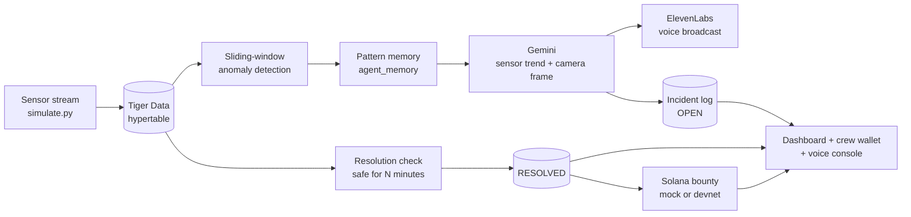

# EcoTwin AI

**An environmental digital twin that watches a city's sensors, explains what it sees, warns residents out loud, and closes the loop when the problem is fixed.**

When a sensor spikes, EcoTwin checks the live data in Tiger Data, looks at a camera frame of the site with Gemini, remembers whether this location has a history of problems, broadcasts a spoken warning with ElevenLabs, and tracks the incident until the readings are safe again. Then it pays the response crew a small bounty on Solana.

> **Live demo:** _add your hosted URL here_
> **Demo video:** _https://youtu.be/L9hkzqzNn2Q?si=WcTUKG3sFAXhYcYi_

---

## The problem

Cities collect plenty of environmental sensor data, but a spike on a chart doesn't protect anyone. Someone has to notice it, work out whether it's real, decide what to do, tell the people affected, and follow up until it's fixed. That chain is slow and manual, and repeat offenders slip through because each event is handled as if it were the first.

## What EcoTwin does

1. **Detects** abnormal readings in real time from a TimescaleDB hypertable on Tiger Data.
2. **Reasons** about them with Gemini, using the sensor trend *and* a camera frame of the site.
3. **Remembers** each location's incident history and flags repeat problems as **systemic patterns**.
4. **Plans** a response using only the resources that actually exist for that zone, with no invented equipment.
5. **Warns** residents with a short spoken broadcast generated by ElevenLabs.
6. **Closes the loop**: once readings stay safe, the incident is automatically marked **RESOLVED**.
7. **Rewards** the response crew with a bounty on Solana (mock or real devnet transaction).
8. **Answers questions by voice**: ask "What's the status of the downtown basin?" and it replies out loud from live data.

## How it works



### Detection
Every 2 seconds, EcoTwin compares each node's last 10 minutes with the hour before. A node is anomalous if its latest reading exceeds the zone's safety limit, its recent average is 3+ standard deviations above baseline, or it has risen 200%+. Alerts fire **once per event**: EcoTwin stays silent while a spike continues and re-arms only after readings fall back below 90% of the limit.

### Reasoning (Gemini)
Gemini receives the live numbers, a 5-minute-bucket trend for the last hour, the camera frame for that node, the node's incident history, and the list of response resources on file. It must reply in a fixed JSON structure (enforced with a response schema): hazard yes/no, severity, root-cause hypothesis, action plan, pattern rationale, and a two-sentence broadcast script.

**Grounding:** the action plan may only use the zone's listed `response_resources`. Anything beyond them must be phrased as "escalate to &lt;agency&gt;". This stops the model from inventing infrastructure.

### Pattern memory
Each incident and resolution is written to an `agent_memory` table, kept separate from the incident log, so the agent's memory survives demo resets. If a node had **2 or more incidents in the last 30 days**, the new one is classified **SYSTEMIC** by a deterministic rule. Gemini gets the history and explains what seems to be recurring. (`backboard_memory.py` provides an optional Backboard.io backend with the same interface.)

### Incident lifecycle
| Status | Meaning |
|---|---|
| `OPEN` | Created when a zone first crosses its limit |
| `RESOLVED` | Readings stayed safe for the whole resolution window: 95% of readings within the limit, none more than 20% over it, sensor reporting throughout |
| `SUPERSEDED` | A new event hit the same node before the previous one resolved (no bounty) |

### Bounties (Solana)
When a hazardous incident resolves, the response crew earns a bounty scaled by severity: a SystemProgram transfer plus a Memo naming the incident.
- **`SOLANA_MODE=mock`** (default): builds the same transaction shape and records it; nothing is sent anywhere.
- **`SOLANA_MODE=devnet`**: sends a real transaction on Solana **devnet** using free test SOL, then tracks confirmation. Every payout links to Solana Explorer.

Safeguards: devnet only (the code refuses mainnet URLs and checks the network before signing), throwaway keys stored locally and gitignored, and an automatic fallback to mock if devnet is unavailable.

### Interfaces
- **Dashboard** (`/`): live chart against the safety limit, status badge, Gemini's verdict with the camera frame, pattern and status badges, alert timing, bounty, history, and the voice broadcast.
- **Voice console** (top of the dashboard): speak (Chrome/Safari) or type a question. Gemini answers only from a read-only snapshot of live Tiger Data, and ElevenLabs speaks the reply. Follow-up questions keep context.
- **Crew wallet** (`/wallet`): a phone-style screen for the response crew that shows each bounty arriving. It is clearly labelled as simulated and only displays database records.

## Tech stack

| Layer | Technology |
|---|---|
| Time-series data | **Tiger Data** (TimescaleDB hypertables on PostgreSQL) |
| Multimodal reasoning | **Google Gemini API** (structured JSON output) |
| Voice | **ElevenLabs** text-to-speech (`eleven_flash_v2_5`) |
| Incentives | **Solana** devnet (`solders`, JSON-RPC, Memo program) |
| Backend / UI | Python, FastAPI, Chart.js, browser Web Speech API |

## Project structure

```
ecotwin_core.py      Detection loop, Gemini + ElevenLabs, incident lifecycle, resolution, bounties
simulate.py          Live sensor simulator (keyboard-controlled contamination spike)
dashboard.py         FastAPI dashboard, crew wallet page, voice console endpoints
voice_console.py     Live-data snapshot + grounded Gemini Q&A for the voice console
agent_memory.py      Long-term per-node incident memory in Tiger Data
backboard_memory.py  Optional Backboard.io memory backend
bounty.py            Bounty payouts (mock or devnet)
solana_devnet.py     Devnet transfer + memo, signing and confirmation
solana_setup.py      One-time devnet wallet setup
frames/402.jpg       Camera frame for node 402
static/              Local Chart.js copy (works without CDN access)
```

## Running it locally

### 1. Install
Requires Python 3.11+.
```bash
pip3 install -r requirements.txt
cp .env.example .env    # then fill in your keys
```

### 2. Configure `.env`
| Variable | Purpose |
|---|---|
| `TIGER_DATABASE_URL` | Tiger Data connection string (`postgres://...?sslmode=require`) |
| `GEMINI_API_KEY`, `GEMINI_MODEL` | Gemini key and a model your key can access (use a current Flash model) |
| `ELEVENLABS_API_KEY`, `ELEVENLABS_VOICE_ID` | ElevenLabs key (Text to Speech + Voices read) and voice |
| `RESOLUTION_WINDOW` | How long readings must stay safe before auto-resolve (`1 minute` for demos, `10 minutes` default) |
| `SOLANA_MODE` | `mock` (default) or `devnet` |
| `AUTOPLAY` | Play alerts through the Mac's speakers (`false` when the dashboard plays them) |

See `.env.example` for every option.

### 3. Create the schema (run once in the Tiger Data SQL editor)
```sql
CREATE TABLE IF NOT EXISTS sensor_nodes (
    node_id SERIAL PRIMARY KEY,
    zone_name VARCHAR(100) NOT NULL,
    latitude DECIMAL(9, 6) NOT NULL,
    longitude DECIMAL(9, 6) NOT NULL,
    sensor_type VARCHAR(50) NOT NULL,
    installed_at TIMESTAMPTZ DEFAULT NOW(),
    response_resources TEXT[]
);

CREATE TABLE IF NOT EXISTS sensor_readings (
    time TIMESTAMPTZ NOT NULL,
    node_id INT REFERENCES sensor_nodes(node_id),
    metric_value FLOAT NOT NULL,
    anomaly_score FLOAT DEFAULT 0.0,
    raw_payload JSONB
);
SELECT create_hypertable('sensor_readings', 'time', if_not_exists => TRUE);
CREATE INDEX IF NOT EXISTS idx_readings_node_time ON sensor_readings (node_id, time DESC);

CREATE TABLE IF NOT EXISTS environmental_incidents (
    incident_id SERIAL PRIMARY KEY,
    detected_at TIMESTAMPTZ DEFAULT NOW(),
    zone_name VARCHAR(100),
    severity_level VARCHAR(20),
    ai_summary TEXT,
    action_triggered BOOLEAN DEFAULT FALSE
);

-- Demo node with the response resources the AI may use
INSERT INTO sensor_nodes (node_id, zone_name, latitude, longitude, sensor_type, response_resources)
VALUES (402, 'Downtown Industrial Runoff Basin', 43.073000, -89.401000, 'water_runoff',
        ARRAY['Rapid-response mobile field crew', 'Public alert broadcast system', 'SMS resident notification'])
ON CONFLICT (node_id) DO NOTHING;
SELECT setval('sensor_nodes_node_id_seq', (SELECT max(node_id) FROM sensor_nodes));
```
EcoTwin adds the remaining columns and tables (incident status, `bounty_payouts`, `agent_memory`) automatically on startup.

### 4. Run (three terminals)
```bash
python3 simulate.py --reset --spike-after 20   # sensor stream; keys: s = spike, n = normal, q = quit
python3 ecotwin_core.py                        # detection + AI + alerts + resolution
python3 dashboard.py                           # http://127.0.0.1:8000  and  /wallet
```
In the dashboard, click **Auto-play alerts** once (browsers only allow sound after a click).

Useful flags:
- `python3 ecotwin_core.py --dry-run --once`: detect and print the Gemini request without calling any API
- `python3 ecotwin_core.py --forget-memory [NODE_ID]`: wipe pattern memory for a clean demo

### Optional: real Solana devnet bounties
```bash
python3 solana_setup.py          # creates throwaway devnet wallets, verifies devnet
# fund the printed treasury address at https://faucet.solana.com (devnet), then:
# set SOLANA_MODE=devnet in .env and restart ecotwin_core.py
```

## Demo walkthrough
1. Normal readings stream in around 13 NTU, well under the 15 NTU limit.
2. A contamination spike starts. Within seconds EcoTwin detects it, Gemini analyzes the readings plus the outfall photo, and a spoken warning plays. The dashboard shows the verdict, the grounded action plan and the alert timing.
3. Ask the voice console: *"What's the status of the downtown basin, and do we have field crews nearby?"*
4. The spike ends, readings stay safe for the resolution window, the incident flips to **RESOLVED**, and the crew wallet receives its bounty.
5. Repeat: by the third event at this node, EcoTwin flags it as a **SYSTEMIC PATTERN** and the action plan targets the recurring source.

## Design decisions and honest limits
- **Sensors are simulated.** Every simulated reading is tagged `{"source": "simulator"}` in the database. The pipeline is real: live Tiger Data queries, real Gemini and ElevenLabs calls.
- **The AI never writes SQL.** The voice console answers from a fixed, read-only snapshot, which is faster, safe, and keeps answers tied to real numbers.
- **No invented facts.** Action plans are limited to listed resources, and crew locations aren't tracked, so EcoTwin says which crews are *on file* rather than claiming any are "nearby".
- **Pattern classification is a rule, not a model guess**, so it's consistent and explainable.
- **Bounties use test currency.** Mock mode sends nothing; devnet mode uses free test SOL with no real-world value.

## Credits
- Camera frame: photo by Ian Ssuuna on [Unsplash](https://unsplash.com/photos/a-large-pipe-is-coming-out-of-the-water-cYfNyw1aswQ) (Unsplash License).
- Built for _hackathon name_ by Aarush Kampani.
